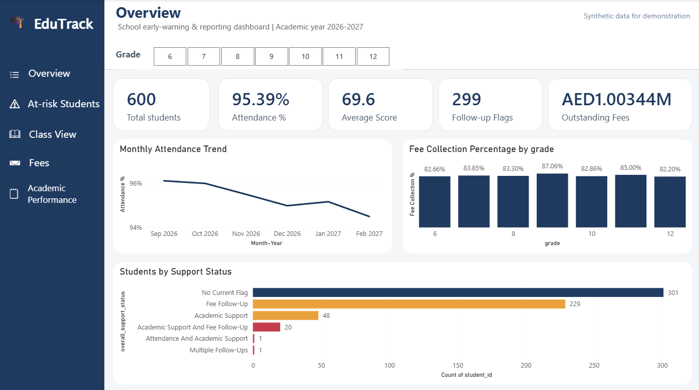
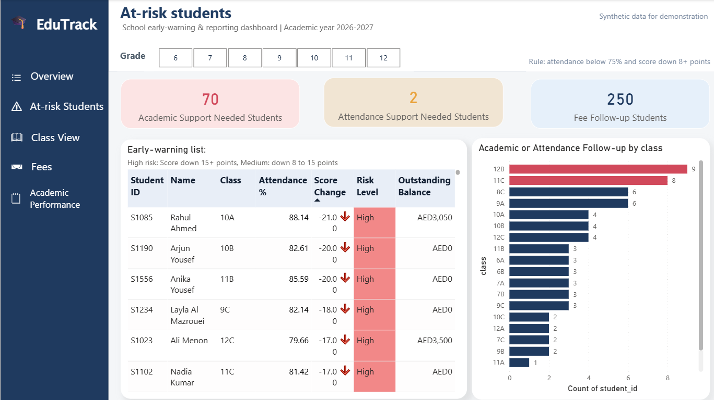
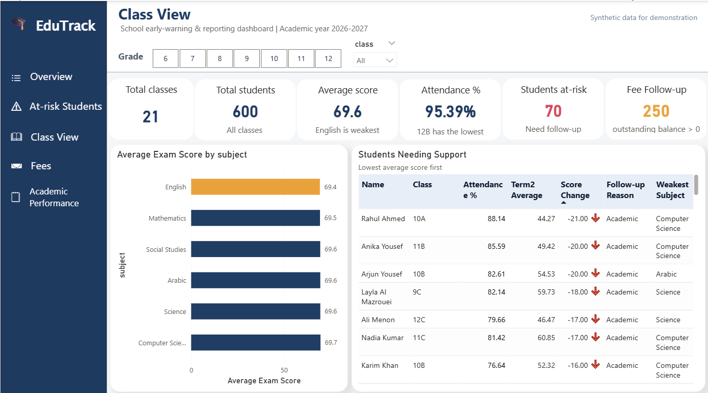
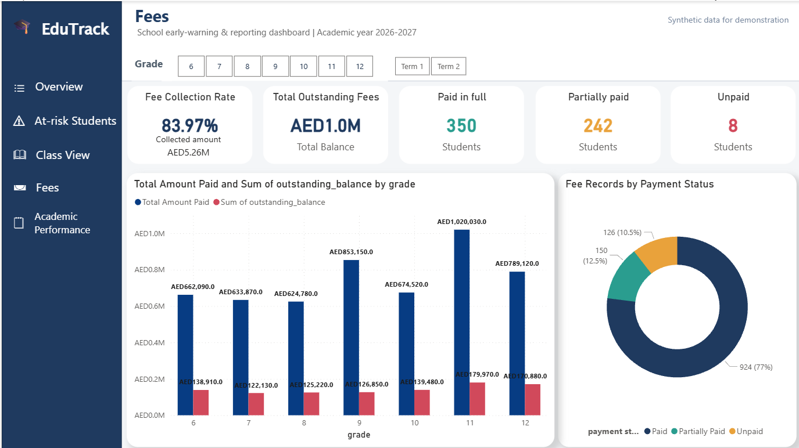
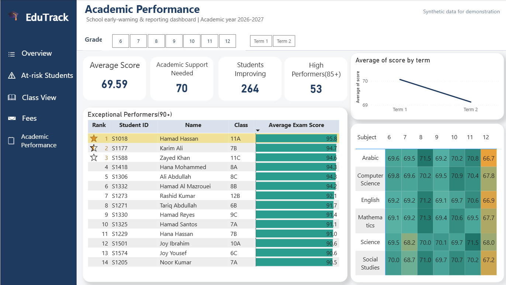

# EduTrack - School early-warning & reporting system

Edutrack is a school analytics and early warning reporting project developed to help school administrators monitor student attendance, academic performance, and fee payment status.
the project uses Python for data cleaning and preparation, MySQL for data storage and querying, and Power BI for interactive dashboards and reporting.
It provides insights into student performance, identifies students who may require additional support, and helps administartors monitor important school indicators.

**Note:** All data in this project is synthetic

## Dashboard preview

**Overview(principal)**

**At-risk studants(early warning list)**

**Class view (techers)**

**Fees**

**Academic performance**

## The problem
a school keeps attendance, exam marks, and fee records in seperate places, so it is hard to see which students need help. EduTrack brings the 3 together , flags students who need academic, attendance or fee follow-up shows each user only what they need and presenting meaningful information through interactive dashboards.

## Project Workflow
1. collected and inspected the school datasets.
2. used Python and Pandas to clean and prepare the data
2. identified missing values, duplicates and potential outliers.
4. exported the cleaned data
5. imported the cleaned data into MySQL.
6. performed SQL queries and created a student-level warning view.
7. Connected MySQL to PowerBI.
8. created relationships, DAX measures and interactive dashboards.
9. validated important Power BI calculations against MySQL results.

## The data
4 synthetic tables for one academic year (2026 - 2027)
1. students table | 600 students in grade 6 to 12 across 21 classes
2. attendance table | daily attendance records , sep to feb
3. exam_results table | scores in six subjects for term 1 and term 2
4. fees table | fee records per students perv term : amount due, amount paid, outstanding balance, payment status

## How it works:
1. **Python (pandas)** : cleaned the 4 datasets , removed duplicates, fixed inconsistent text and spacing, handled missing scores, kept blank payment dates for unpaid fees and added a payment status column.
2. **MySQL** : loaded the cleaned data into database called edutrack . wrote SQL using joins, GROUP BY , HAVING, CASE WITH, CTEs and created a student level warning view.
3. **Power BI** : connected to MySQL , shaped the data in Power Query, built relationships between tables , wrote DAX measures, and designed five linked report pages with slicers, a custom theme and tooltip pages.

## Early warning rules
- **Academic Support** :  a students average score fell by 8 or more points from Term 1 to Term 2 . High risk is when fall is 15 or more points; Medium risk is a fall of 8 to 15 points.
 - **Attendance Support** : attendance below 75%
 - **Fee Follow-up** : outstanding fee balance greater than 0

 ## Tools used
 Python(Pandas), MySQL, Power BI(Power Query, DAX), VS code, GitHub

 ## Folder structure
- 'data/raw_data' : original synthetic files
- 'data/cleaned_data' : files after cleaning
- 'python' : Cleaning and loading scripts
- 'sql' : database setup and analysis queries
- 'powerbi' : the Power BI file
- 'screenshots' : dashboard images

## How to run it
1. install the python tools: 'pip install -r requirement.txt'
2. create a MySQL database called 'edutrack'
3. run cleaning and loading scripts in the python folder
4. run SQL files in the sql folder
5. open power bi file in Power BI Desktop

## Recommendations from this
- Contact the 70 students with a score drop of 8+ points first , starting with the high risk group (dropped 15+ points) and give them extra support in their weak subjects.
- Look at why attendance falls month by month and check first the classes with the most follow-ups (12B and 11C)
- Send fee reminders to the 250 students with an outstanding balance, starting with grade 12 (lowest collection class)

## Limitations:
- The data is synthetic
- Risk thresholds are simple rules and would need to be agreed with a real school

## About me
Ahsana, M.Sc. Computer Science, Certified in Python Django and Data analysis
Contact : ahsanakk55@gmail.com
